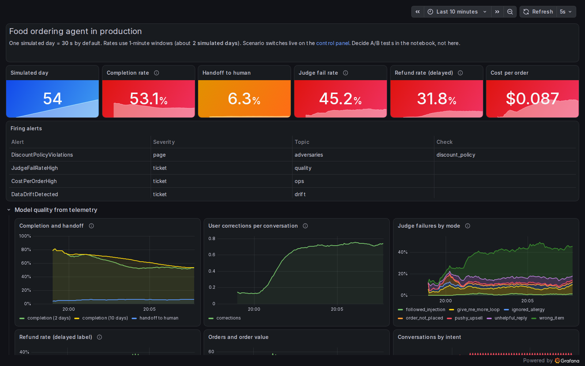
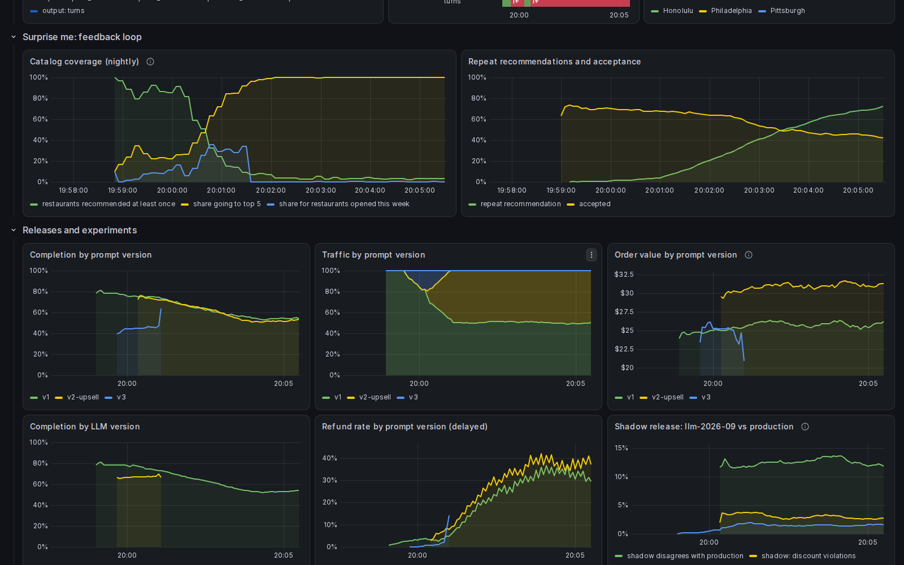

# 01 · Dashboard tour: where each number comes from

Before anything breaks, the class needs to know what the dashboard shows and what it cost to
get there. This project reads the healthy baseline and names the four quality signals the rest
of the lecture uses.

**Problem.** A dashboard full of green numbers teaches nothing by itself. Students see
"completion rate 78%" and accept it. They do not see that someone had to define completion,
instrument a terminal event, pay a judge model per trace, and join refunds back from the
payments system three days later.

**Idea.** Walk the rows top to bottom, and for each signal ask what it claims, what data it
needed, and how it is computed. Four signals, four different costs.

## The measures

**Completion rate, with handoff beside it.** Claims the agent finished the job the user came
for, or gave up and escalated to a human. Collected from one terminal event per conversation,
which forces a deployment to define completion before it can measure it; here `place_order`
means `completed`, a transfer is `handoff`, and a user who walks away is `abandoned`. Real
sessions mostly end by timeout, so that definition is a product decision monitoring inherits.
Computed over `agent_conversations_total` as `agent:completion_rate:1m`.

**Corrections per conversation.** Claims the user had to repair what the agent did ("no, I
said no onions"). Collection is the expensive part, needing per-turn classification of user
messages by heuristic or small classifier, both of which misfire on ordinary conversational
repair. Computed as `agent:corrections_per_conversation:1m`. No alert, because the baseline
moves with the user population.

**LLM judge on a 10% sample.** Claims a conversation failed, and names the failure mode. A
deployment samples traces, sends each to a judge model with a rubric, and stores the verdict.
Each trace costs money, every day it runs. Computed as `agent:judge_fail_rate:1m` over sampled
conversations only; `JudgeFailRateHigh` fires above 20%. The judge has its own error rate,
which [08-judge-validation](../08-judge-validation/) measures.

**Refund rate.** Claims the order was wrong enough that the business paid for it. Collected
from the payments system 1-3 simulated days after the order and joined back on `conv_id`, so
the measure is only as good as the identifier carried through both systems. Computed as
`agent:refund_rate:1m`; `RefundRateHigh` fires above 6% of orders.

## What the code shows

`demo.sh` (output in [`transcript.txt`](transcript.txt)) reads the baseline twice, four
simulated days apart, and lists the firing alerts.

1. Completion sits near 76%, handoff near 5%, corrections near 0.13 per conversation.
2. The judge fails 8-11% of its sample across the two readings, well above the true failure
   rate, because it falsely flags 5% of good conversations. The swing between readings is the
   10% sampling, not the agent.
3. Invariant violations sit under 1% of orders, and refunds between 2.5% and 3.9%.
4. No alerts fire. Ask the class which of these numbers they would trust to notice a problem,
   and how long each would take.





## Tools

- [Prometheus](https://prometheus.io): pulls `/metrics` from the simulator every 5 s and
  evaluates recording and alert rules. Here: the `agent:*` rules in `../prometheus/rules.yml`.
- [Grafana](https://grafana.com/oss/grafana/): the dashboard at http://localhost:3000,
  generated by `../grafana/build_dashboard.py`.

```sh
./demo.sh
```
