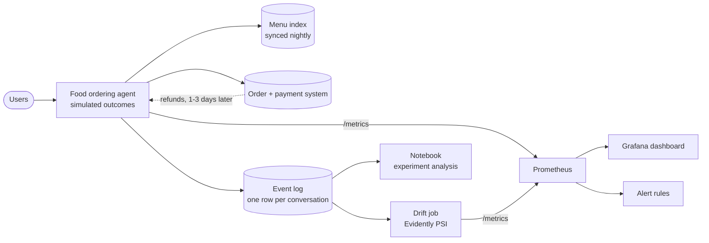
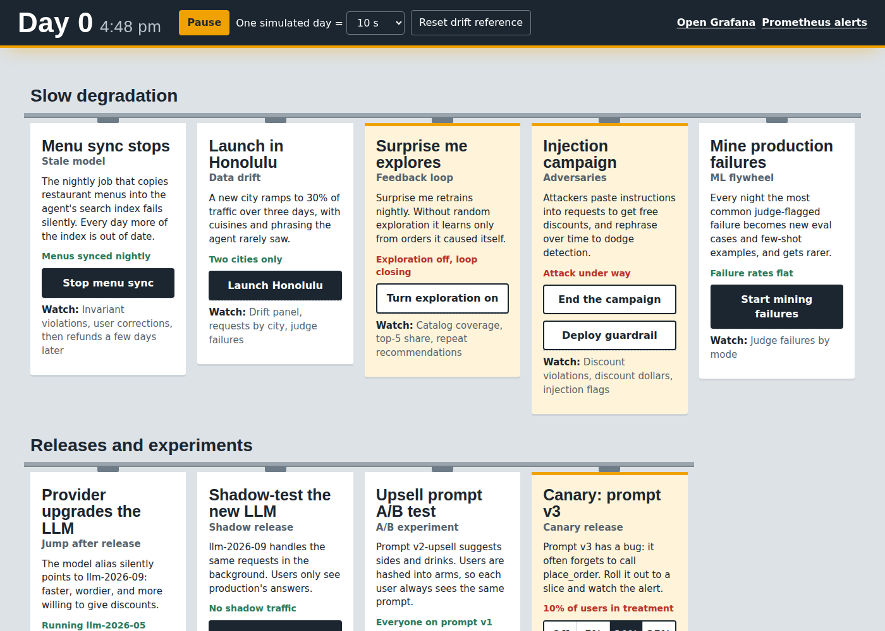

# Testing in Production: code for the lecture

Runnable examples for the lecture *Testing in Production* of the course
[Machine Learning in Production](https://mlip-cmu.github.io) (see also the book chapters
[Testing and Experimenting in Production](https://mlip-cmu.github.io/book/19-testing-in-production.html)
and [Quality Assurance Basics](https://mlip-cmu.github.io/book/12-quality-assurance-basics.html)).
Each folder drives one scenario on a shared stack and shows which signal catches it.

## Case study: a food ordering agent

An LLM agent takes food orders in chat. It searches a menu index, builds a cart, and calls
`place_order`. Telemetry from every conversation goes to Prometheus and Grafana, a drift job
compares today against a reference window, and refunds arrive from the payments system a few
days later. A control panel lets the instructor break things on purpose.





The agent is simulated. `simulator/engine.py` generates conversation *outcomes* rather than
text: intent, prompt and LLM version, turns, tool calls, the order, invariant results, a judge
verdict on a 10% sample, and refunds that arrive later. No LLM is called, effects are
exaggerated so they are visible within minutes, and **one simulated day takes 30 real seconds**.
Fields prefixed `truth_` are what a real team would not have; the dashboard never shows them.

## Projects

| Lecture topic (slides) | Project | Signal it exercises |
|---|---|---|
| Monitoring model quality in production | [01-dashboard-tour](01-dashboard-tour/): what healthy looks like, and where each number comes from | completion, corrections, judge, refunds |
| Releases; shadow releases | [02-release-jump](02-release-jump/): the provider swaps the model under you; shadow-test it first | cost per order, discount invariant, shadow comparison |
| Slow degradation; data drift; feedback loops; adversaries | [03-slow-degradation](03-slow-degradation/): four failures that never jump | trend alerts, PSI drift, catalog coverage, injection flags |
| Monitoring without ground truth | [04-invariants](04-invariants/): four checks that need no labels | menu, price, discount, allergy |
| Chaos engineering | [05-chaos-outage](05-chaos-outage/): kill the menu API and watch the agent invent items | tool errors, latency, hallucinated items |
| A/B testing | [06-ab-experiment](06-ab-experiment/): why the dashboard cannot decide an experiment | per-arm metrics, Welch t-test, peeking |
| Canary releases | [07-canary](07-canary/): a bad prompt reaching 10% of users | per-arm completion, blast radius |
| Who validates the validator? | [08-judge-validation](08-judge-validation/): the LLM judge against 16 hand-labeled traces | judge TPR/TNR, corrected failure rate |

## How to read and run

You can read everything on GitHub without running anything. Each project folder has a README,
a `demo.sh`, and a `transcript.txt` with that demo's output. The notebook in
[`notebook/`](notebook/) is committed with its outputs, and
[`notebook/lecture_notebook.html`](notebook/lecture_notebook.html) is an offline export.

To run the demos you need [Docker](https://docs.docker.com/get-docker/) and
[uv](https://docs.astral.sh/uv/).

```sh
docker compose up --build -d      # start the stack; first run pulls images
./run_all.sh                      # every scenario in order, writing the transcripts
./run_all.sh 05-chaos-outage      # one scenario
docker compose down               # stop everything
```

| What | Where |
|---|---|
| Control panel (instructor) | http://localhost:8000 |
| Grafana dashboard | http://localhost:3000 (anonymous viewer; `admin` / `admin` to edit) |
| Prometheus alerts | http://localhost:9090/alerts |

**Before class.** Pull and build at home, not on classroom Wi-Fi. Start the stack about five
minutes before you present, so there are ~10 simulated days of healthy baseline. The drift job
needs two full days before it reports, and the "vs. last week" alert needs seven. Flip one
scenario at a time, or the effects blur together.

## The three questions for every measure

The lecture asks the same three questions of each signal, and every project README answers
them in order:

1. **What does the measure claim** about the agent?
2. **What data must a deployment collect** before the measure exists at all? This is where the
   engineering time goes, and it is the question a slide skips.
3. **How is the number computed** from that data?

Recording rules and alert thresholds live in [`prometheus/rules.yml`](prometheus/rules.yml).
One conversation is one row in `data/events/day_*.jsonl`. At the default speed,
`rate(...[1m])` covers about two simulated days and `[5m]` about ten.

## What is shared

| Folder | Contents |
|---|---|
| [`simulator/`](simulator/) | the agent simulator, the control panel, and the metrics it exports |
| [`drift/`](drift/) | the Evidently job comparing recent conversations against a reference window |
| [`prometheus/`](prometheus/) | scrape config, recording rules, alert rules |
| [`grafana/`](grafana/) | the dashboard, generated by `build_dashboard.py` rather than edited as JSON |
| [`notebook/`](notebook/) | the analysis the dashboard cannot do, generated by `build_notebook.py` |
| [`tools/`](tools/) | `scenario.py`, which every `demo.sh` calls to drive the stack |
| [`data/sample/`](data/sample/) | a 30-day replay of a scripted run, so the notebook works without Docker |

Label cardinality is kept low on purpose: no user, restaurant, or free-text labels. Everything
carries `prompt_version` and `llm_version`, and the three quality counters also carry `city`.
Those choices decide which questions you can ask during an incident, and you make them before
the incident happens. [03-slow-degradation](03-slow-degradation/) shows what that costs.
